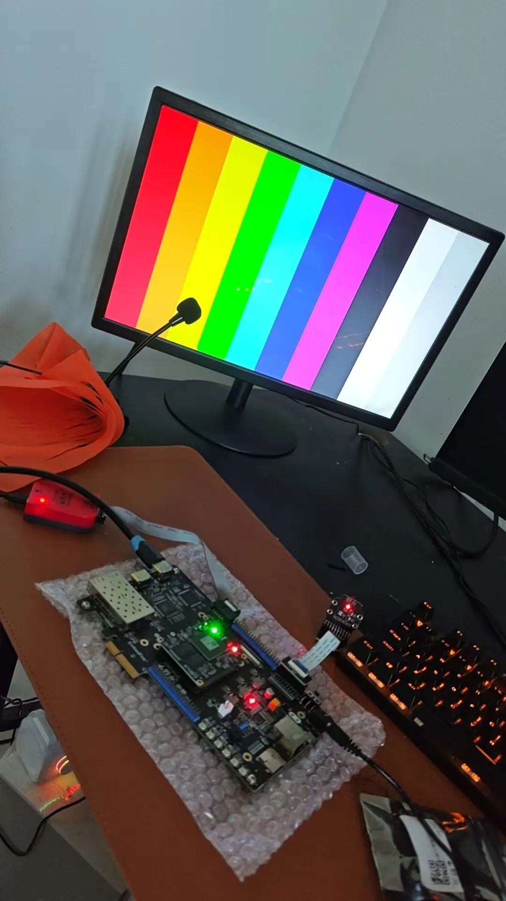
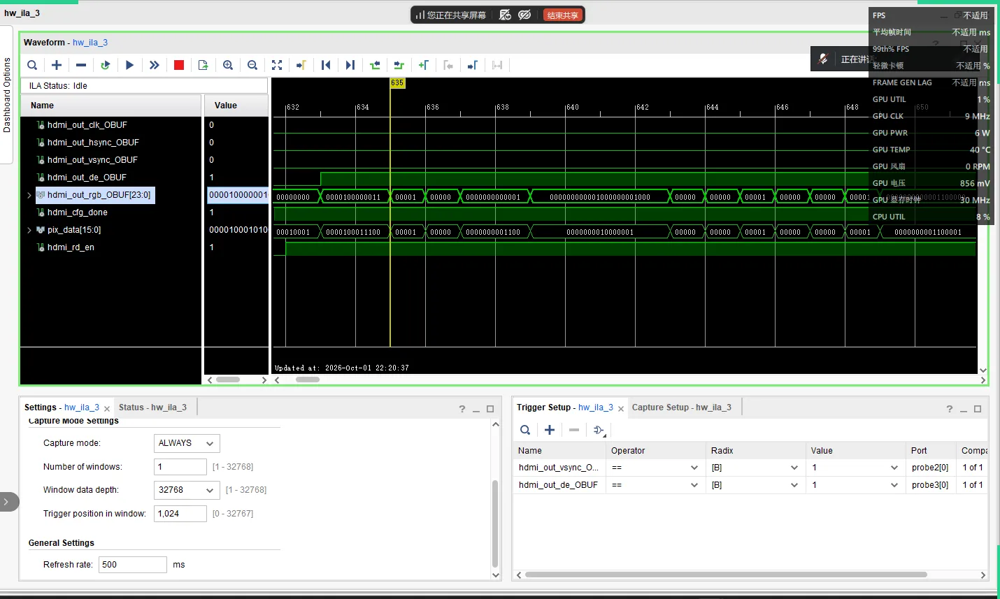
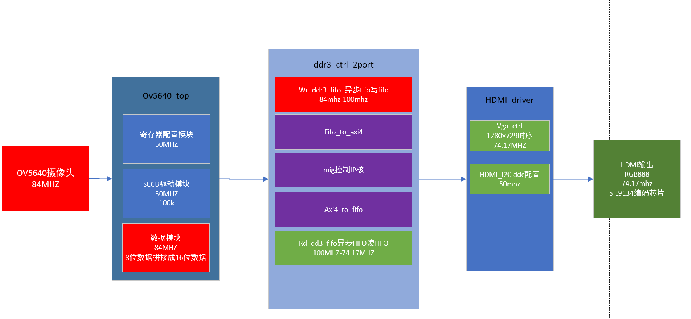
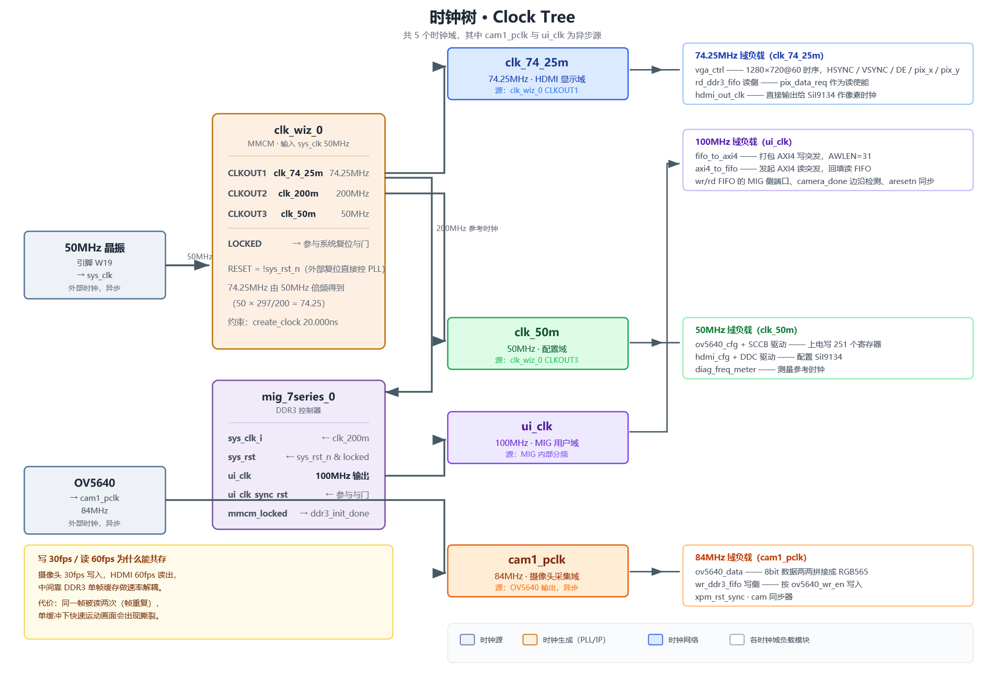
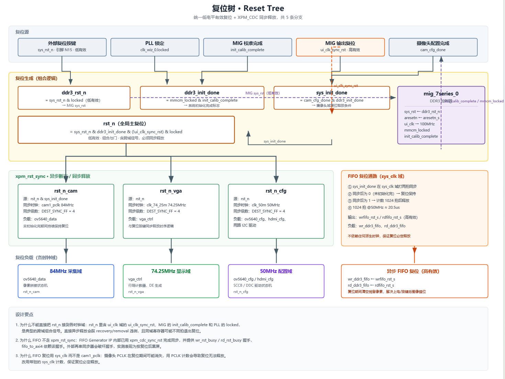
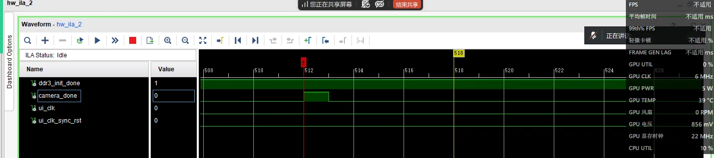
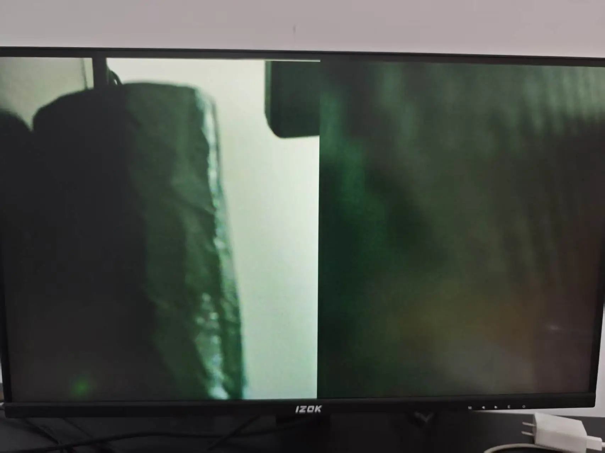
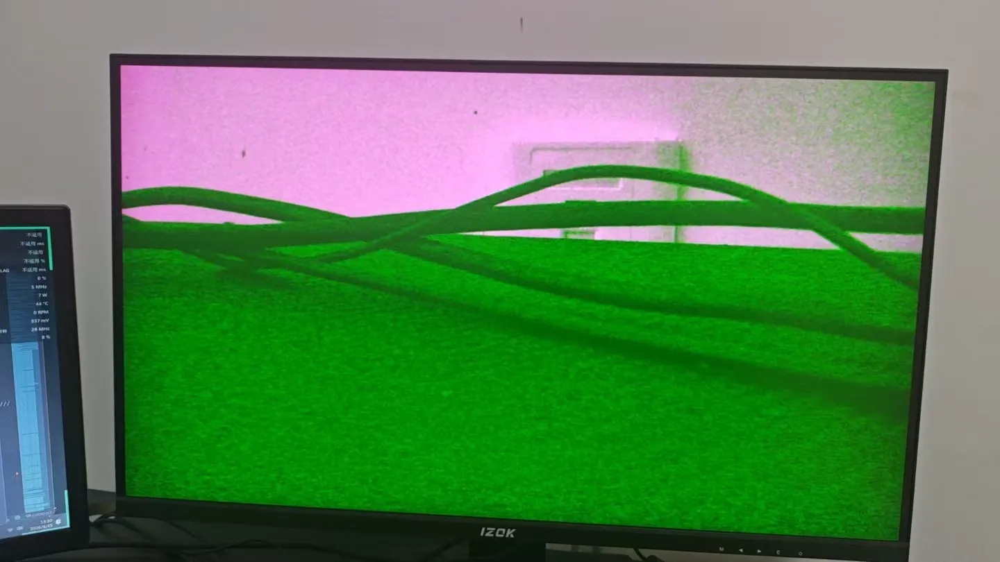
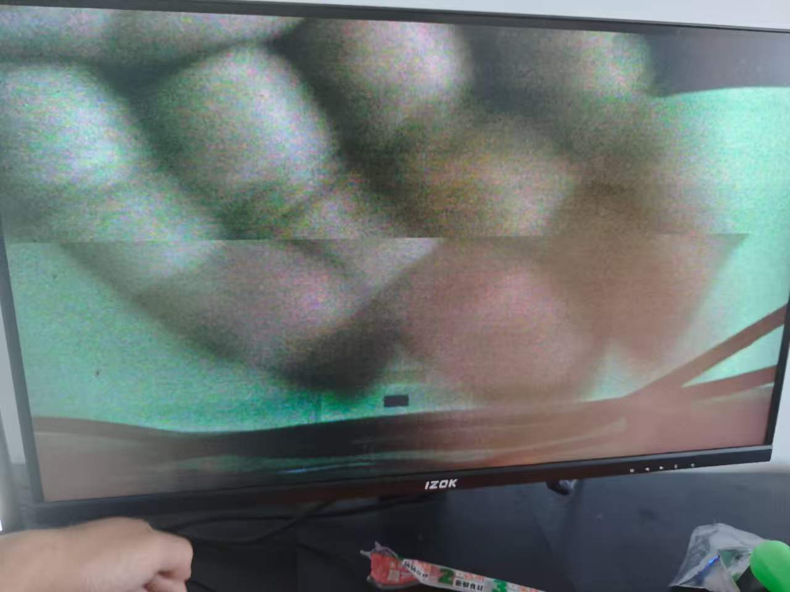
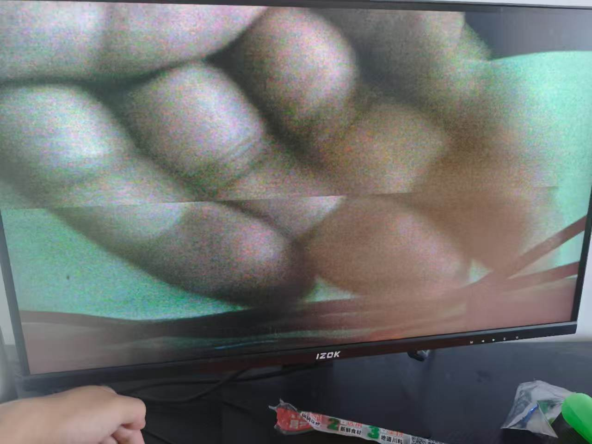

# OV5640 + DDR3 + HDMI 图像采集显示系统

  

在 XC7A200T 上跑通的一条完整视频通路：OV5640 采集 720P 图像，写进 DDR3 做帧缓存，再按 720P@60 的时序读出来送 HDMI 显示。

写这个的动机很直接——把采集、缓存、显示三段串起来之后，跨时钟域和复位这两块必须自己想清楚。这两件事分开看代码都很简单，问题是串起来之后，一个异步释放就能让你对着屏幕上一堆错位的色块查一整天。

## 实拍



这是 `COLOR_TEST=1` 时的彩条模式：跳过摄像头和 DDR，直接由 FPGA 生成八色竖条。用来快速判断问题在采集端还是显示端——彩条对，说明 HDMI 通路没问题，麻烦在前面。



ILA 抓的 HDMI 输出侧时序，从上到下是 `hdmi_out_clk`、`hsync`、`vsync`、`de`、`rgb[23:0]`。

---

## 系统规格

| 项目 | 参数 |
| --- | --- |
| FPGA | Xilinx Artix-7 xc7a200tfbg484-2 |
| 工具版本 | Vivado 2018.3 |
| 摄像头 | OV5640，1280×720，RGB565，30 fps |
| 输入接口 | DVP 8bit（pclk / vsync / href / data[7:0]） |
| 配置接口 | SCCB（兼容 I2C），上电写 251 个寄存器 |
| 帧缓存 | DDR3，MIG 7-series，32bit 数据总线 |
| 显示输出 | HDMI 1280×720 @ 60 fps |
| 显示芯片 | SiI9134，经 DDC（I2C）配置 |
| 系统时钟 | 50 MHz 板载晶振（引脚 W19） |

摄像头 30fps 写入、HDMI 60fps 读出，速率不等也能跑，靠的是中间的 DDR3 做解耦。代价是同一帧会被显示两次，而且画面一动就会出现撕裂，原因见文末。

---

## 系统架构



数据流向：上面一行采集（左→右）写进 DDR3，下面一行显示（右→左）读出来送 HDMI。

几个关键节点：

- **ov5640_data** 把 DVP 的 8bit 数据两两拼成 16bit 的 RGB565，同时给出写使能
- **wr_ddr3_fifo** 做第一次跨时钟域，写侧 84MHz、读侧 100MHz，顺带完成 16bit→128bit 的位宽转换
- **fifo_to_axi4** 把拼好的数据打包成 AXI4 写突发，`AWLEN = 31`，一次 32 拍共 512 字节
- **axi4_to_fifo** 反向，发起读突发后回填到读 FIFO
- **rd_ddr3_fifo** 第二次跨时钟域，从 100MHz 回到 74.25MHz 的显示时钟
- **vga_ctrl** 生成 1280×720@60 的行场时序，顺便给出读请求

配置通路独立跑在 50MHz：摄像头走 SCCB（16bit 寄存器地址），SiI9134 走 DDC（8bit 地址）。这两条共用同一套 I2C 驱动逻辑，各自例化一份。

---

## 时钟域

整块设计一共 5 个时钟域，其中 `cam1_pclk` 来自摄像头、不是本时钟系统产生的，属于真正的异步源。



| 时钟 | 频率 | 来源 | 主要负载 |
| --- | --- | --- | --- |
| `sys_clk` | 50 MHz | 板载晶振 W19 | clk_wiz_0 输入 |
| `clk_74_25m` | 74.25 MHz | PLL CLKOUT1 | vga_ctrl、rd_ddr3_fifo 读侧、hdmi_out_clk |
| `clk_200m` | 200 MHz | PLL CLKOUT2 | MIG 参考时钟 |
| `clk_50m` | 50 MHz | PLL CLKOUT3 | SCCB / DDC 配置、频率计 |
| `cam1_pclk` | 84 MHz | 摄像头输出 | ov5640_data、wr_ddr3_fifo 写侧 |
| `ui_clk` | 100 MHz | MIG 输出 | AXI4 读写两端 |

约束上把 `cam1_pclk` 单独异步出去：

```tcl
create_clock -period 11.905 -name cam1_pclk [get_ports cam1_pclk]
set_clock_groups -asynchronous \
    -group [get_clocks -include_generated_clocks sys_clk] \
    -group [get_clocks -include_generated_clocks cam1_pclk]
```

`cam1_pclk` 没走专用时钟引脚，走的是普通 IO，所以约束里带了 `set_property CLOCK_DEDICATED_ROUTE FALSE`。这不是偷懒——这块板子的摄像头接口就是这么连的，代价是时钟抖动比专用引脚差一些。

---

## 复位设计

这是整个项目里最绕的部分，单独画了一张图。



### 问题

最开始的写法是把复位做成一个组合与门，直接扇出到三个时钟域：

```verilog
assign rst_n = sys_rst_n & ddr3_init_done & (!ui_clk_sync_rst) & locked;
```

下面各模块清一色 `always @(posedge clk or negedge rst_n)` —— 这是异步释放。风险有两个：释放沿可能落在目标时钟的建立/保持窗口里导致 recovery/removal 违例；同域内不同寄存器可能不是同一拍退出复位，状态机初值不一致。

### 解法

用 Xilinx 的 `xpm_cdc_async_rst` 原语（异步断言、同步释放）给每个时钟域各生成一份：

```verilog
xpm_cdc_async_rst #(
    .DEST_SYNC_FF   (4),
    .INIT_SYNC_FF   (0),
    .RST_ACTIVE_HIGH(0)     // 本项目 rst_n 为低有效
) u_rst_sync_cam (
    .src_arst (cam_rst_src),
    .dest_clk (cam_clk),
    .dest_arst(rst_n_cam)
);
```

选原语而不是手写两级 FF，是因为它自带 `ASYNC_REG` 属性，布局时会把同步寄存器放紧邻，亚稳态概率比手写低；时序约束也由原语自带，不用再手写 `set_false_path`。

采集域（`rst_n_cam`）额外串了一个条件：`src_arst = rst_n & sys_init_done`。意思是摄像头没配置完之前，采集端一直按着复位不放——配置过程中摄像头输出的数据是乱的，与其接收了再丢，不如从源头卡住。

### FIFO 单独走一路

读写两个异步 FIFO **没有**接上面这三条复位。原因是 FIFO IP 内部已经做了复位同步，外面再串一级同步会破坏它的 busy 握手时序。

这两个 FIFO 的复位由底层 `ddr3_ctrl_2port` 自己生成：`sys_init_done` 在 `ui_clk` 域打两拍同步，确认为 0（未初始化完成）就保持复位；确认为 1 之后再数 1024 拍才释放。多等这 1024 拍是为了让 DDR3 读写通路彻底稳定，避免第一帧写入时控制器还没准备好。



上面两条是 `ddr3_init_done` 和 `camera_done`，下面两条是 `ui_clk` 和 `ui_clk_sync_rst`。可以看到初始化完成后 `camera_done` 开始周期性拉脉冲，每帧一次。

---

## 调试记录

留着这些截图是因为踩过的坑比代码本身有价值。



> **上电后第一帧图像错位、花屏。** 定位到 FIFO 里残留了上一次的数据。上面说的 FIFO 释放后多等 1024 拍，就是补这个洞的——复位释放太快时 FIFO 内部指针还没同步完，第一帧读出来的东西就是错的。



> **整体偏绿、画面分屏。** 两个原因叠加：一是 OV5640 的寄存器配置没生效，输出格式和下游解码对不上；二是 RGB565 转 RGB888 时高位和低位的补零位数搞错了。这类问题用彩条模式一测就能二分定位。

`rtl/freq_meter/` 里放了个频率计也是为了这些：实测摄像头 PCLK 频率、摄像头帧率、HDMI 帧率，以及 VSYNC 高电平宽度和帧周期。这个模块只读取信号，不接进数据通路，剪掉不影响显示。输出端口都加了 `mark_debug`，综合后在 Vivado 里 Tools → Set Up Debug 直接挂 ILA 看。

有个坑值得记一下：加完频率计之后 WNS 掉到 -2.511ns。原因是 74.25MHz 和 50MHz 是同一个 MMCM 的输出，Vivado 会对它们之间的路径做真实时序分析，而那条路其实只是两级同步器。补一个 `constrs/diag_cdc.xdc` 设伪路径就回去了。

---

## 目录结构

```
.
├── README.md
├── LICENSE                    MIT
├── create_project.tcl         一键重建 Vivado 工程
├── .gitignore / .gitattributes
│
├── rtl/
│   ├── top/ov5640_ddr_hdmi.v  顶层连线
│   ├── camera/                OV5640 采集：SCCB 配置 + 8→16bit 拼接
│   ├── ddr3/                  FIFO ↔ AXI4 适配 + MIG 封装
│   ├── hdmi/                  DDC 配置 + VGA 时序
│   ├── freq_meter/            板级频率与帧率测量（调试用）
│   └── xpm_cdc/               跨时钟域复位同步
│
├── constrs/                   引脚约束 + CDC 伪路径
├── ip/                        Vivado IP（只入库 .xci / .prj）
├── sim/                       仿真顶层，详见 sim/README.md
├── docs/                      设计文档与图
├── IO/                        开发板引脚映射表
└── DEBUG/                     调试过程截图
```

`ov5640_ddr3_hdmi_new.xpr` 不入库。`.xpr` 里写死了生成它的机器上的绝对路径，换台电脑就打不开——这正是 `READ_ME.txt` 里提到"路径已损坏"的原因。统一用下面的脚本重建。

---

## 重建工程

```bash
cd <本仓库目录>
vivado -mode tcl -source create_project.tcl
```

脚本里的路径是用 `[file dirname [info script]]` 动态算的，放哪个目录都能跑。它会建好工程、加完所有源文件和约束、配好 IP。之后在 Vivado 里跑综合 → 实现 → 生成比特流即可。

IP 用的是 `ip/` 下的 `.xci` 配置文件，Vivado 会自动重新生成对应的 HDL，因此仓库里不会出现 IP 的生成物。

---

## 已知限制

### 单缓冲引起的撕裂

这是单缓冲最直观的代价。两张实拍：

 

两张图里那条横贯画面的水平接缝，位置明显不一样——左边那张在画面上部约三分之一处，右边那张在中部偏下。**接缝位置不固定这件事本身就是判断依据。**

成因是 DDR3 里只开了一帧的缓冲，写端和读端操作同一块地址：`camera_done` 拉高表示写满一帧，之后写端立刻从头开始覆盖下一帧；显示端则完全按自己的 60fps 节奏往外读，两边之间没有握手。

所以当写端开始写新一帧、而读端正读到画面中间某一行时，读端上半屏拿到的是上一帧的尾部、下半屏拿到的是新帧的开头，接缝就出现在那个交汇点上。又因为 60fps 和 30fps 之间没有严格锁相，读写指针每次相遇的行号都不一样，接缝位置也就一直在漂。

静止画面看不出来——相邻两帧内容几乎相同，切了也分辨不出。镜头一动，接缝立刻可见。

要彻底解决得开双缓冲做乒乓：写 A 读 B，写满一帧后翻转地址，读写永远落在不同区域。代价是多占一帧 DDR3 空间，而且翻转时机必须对齐 VSYNC，落在帧中间切的话还是会撕。三缓冲能容忍更大的读写速率差，代价是延迟增加一帧。

> 顺带说明一下上面两张图的画质：手机的摄像头对着屏幕翻拍，摩尔纹和噪点都很重，加上当时 OV5640 还没完全配好颜色，画面偏色。这些都是拍摄和传感器的问题，接缝本身则是单缓冲造成的。

### 其他

- `cam1_pclk` 走普通 IO 而非专用时钟引脚，抖动指标比专用时钟差
- RGB565 转 RGB888 用的是低位补零，没有做色阶补偿，暗部会有轻微色带

---

## License

MIT，见 [LICENSE](LICENSE)。

`sim/` 下的 DDR3 仿真模型是 Micron 的知识产权，未随本仓库发布，需要自己下载，见 [sim/README.md](sim/README.md)。
